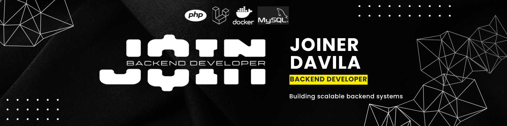

  

 

## 🧑‍💻 About me

Full Stack Developer with **3 years of experience** building and shipping production systems with **PHP/Laravel and Vue 3**, and projects delivered in **Python/Django**. I specialize in RESTful APIs, MySQL performance, asynchronous processing with queues and legacy modernization.

I care about writing clean, maintainable code — not just code that works.

- 🔭 Currently building backend systems for security operations platforms used by 100+ companies
- 🧑‍🏫 Code reviewer in a 6-dev team and mentor to a new developer
- 🌱 Growing in **AWS** (Lambda, API Gateway, Bedrock) and data processing
- 📍 Based in Bogotá, Colombia

---

## 🛠️ Tech Stack

**Backend**

**Frontend & Mobile**

**Database**

**DevOps, Cloud & Testing**

---

## 📈 Highlights

- 🔄 Led the upgrade of my company's largest project from **Laravel 8 → 13** and **PHP 8.1 → 8.5** (dependency & vulnerability cleanup, domain/service architecture, Pest tests)
- ⚡ Cut a statistics module from **15s → under 1s** on millions of geolocation records (query rewrites, composite indexes, schema changes)
- 🔁 Removed an N+1 issue: **~90 DB calls → 1** per request
- 💳 Built an e-commerce platform with **Wompi** payments and two-way **Siigo** accounting sync — **~800 orders/week** in production
- 📄 Built async PDF/XLSX exports with Laravel Jobs & Redis, off the request thread

---

## 🚀 Featured Projects

### 🅿️ [Smart Parking Management System](https://github.com/joinernix231/Parqueadero-Back)
Full-stack parking system with vehicle control, payments, admin dashboard and PDF receipts.
`Laravel 11` `Angular` `MySQL` `Docker` `Clean Architecture` `Repository Pattern` `DTOs`

### 🏢 [Impeercol – Production Web Platform](https://github.com/joinernix231/impeercol-laravel)
Platform for an impermeabilization company — live at [impeercol.com.co](https://impeercol.com.co).
Product catalog with 80+ SKUs, admin panel, SEO and image management.
`Laravel` `Blade` `MySQL` `Production`

---

## 📫 Contact

